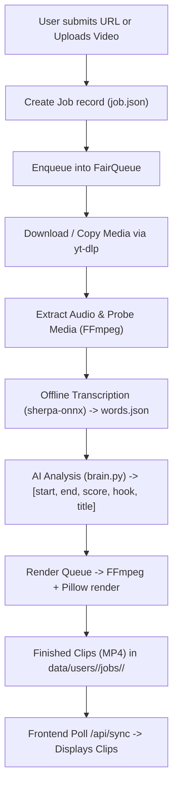

# Technical Assessment: Automated Podcast-to-Shorts Intelligence

**Project:** Clipsora  
**Feature:** AI-Powered Automated Podcast-to-Shorts Intelligence & Viral Scoring Engine  
**Author:** Senior Full-Stack & AI Systems Architect  
**Date:** November 2026  

---

## 1. Existing Application Architecture

Clipsora is a self-hosted clipping studio designed to run as a single-process FastAPI application on either a local workstation (via Python or standalone Docker) or a Linux server (via Docker Compose with PostgreSQL and Caddy).

- **Web Server & Routing:** FastAPI ASGI application (`studio/server.py`) with domain-separated routers under `studio/routers/`:
  - `pages.py`: Landing, auth, legal, reset pages.
  - `auth.py`: Sign-up, login, logout, password reset, session verification.
  - `jobs.py`: Project/job creation from URLs (`yt-dlp`) and file uploads.
  - `uploads.py`: Chunked, resumable file upload handling.
  - `clips.py`: Per-clip re-rendering, caption editing, 3-variant hook generation.
  - `projects.py`: Bulk deletion, project removal, zip export.
  - `people.py`: Creator workspaces and settings.
  - `ai.py`: AI provider settings, key validation, and model discovery.
  - `postqueue.py`: Social media auto-posting queue.
  - `admin.py`: Administrator dashboard, user management, quotas.
  - `media.py`, `notices.py`, `storage.py`, `dashboard.py`: File delivery and utilities.
- **Task Scheduling & Queue:** `studio/jobs.py` implements an in-memory fair queue (`_FairQueue`) managing concurrent video downloads, local transcription, AI moment discovery, and FFmpeg video rendering threads with CPU/memory load governance (`studio/load.py`).
- **Data Persistence:**
  - Relational database (`studio/db.py`) for users, sessions, AI token usage, email tokens, feedback, notices, and admin logs.
  - Per-user file hierarchy under `data/users/<uid>/` storing `jobs/<jid>/job.json`, `words.json`, clip video files, and thumbnail images.
- **Frontend Architecture:**
  - Build-free Single Page Application (`web/index.html`) using semantic HTML5, modern vanilla JavaScript (ES2022), and CSS custom properties (`web/tokens.css`).
  - Real-time updates delivered through a version-counter polling endpoint (`/api/sync?v=N`).

---

## 2. Existing Working Features

1. **Multi-Source Ingestion:** Supported video links (YouTube, Twitch, Kick) via `yt-dlp`, plus direct local video file uploads.
2. **On-Device Speech Recognition:** Offline transcription using `sherpa-onnx` and the NeMo Parakeet TDT 0.6B model, producing word-level timestamps.
3. **AI Video Analysis:** LLM-based clip selection supporting Google Gemini, OpenAI, Anthropic Claude, Groq, xAI Grok, OpenRouter, and local Ollama.
4. **Vertical Video Rendering Engine:** FFmpeg-based 9:16 vertical video reframing (1080x1920) with blurred background padding, facecam framing, and 14 animated caption styles.
5. **Interactive Clip Editor:** In/out timestamp trimming, title/hook rewriting, variant openings selection, and word-by-word subtitle corrections.
6. **Social Media Publishing:** Direct posting to YouTube Shorts, Instagram Reels, and TikTok with daily rate limits and schedule spacing.
7. **Multi-User & Single-User Support:** Opens directly to the studio locally with zero sign-in; optional multi-tenant mode (`CLIPSORA_ACCOUNTS=1`) with email/Google auth.

---

## 3. Current Video-Processing Workflow



---

## 4. Existing AI and Transcription Capabilities

- **`studio/ai.py`:**
  - Normalized chat abstraction for all major providers (`gemini`, `openai`, `anthropic`, `xai`, `groq`, `openrouter`, `ollama`, `custom`).
  - Automatic JSON extraction, response sanitization, exponential backoff on HTTP 429/503 rate limits, model fallback chains, and detailed token usage logging (`usage` table).
- **`studio/transcribe.py`:**
  - Fast, private offline transcription using the `sherpa-onnx` runtime and NVIDIA NeMo Parakeet TDT 0.6B int8 model.
  - Produces structured word items: `{"w": word, "s": start_sec, "e": end_sec}`.
- **`studio/brain.py`:**
  - Sliding window transcript segmentation (15 min window, 60s overlap).
  - Prompts currently focus on short-form gaming/streaming highlights (loudness peaks, chat activity, rage/clutch).

---

## 5. Existing Database Structure

Defined in `studio/db.py` via SQLAlchemy Core (compatible with SQLite and PostgreSQL):
- `users`: User identity, password hash, email, admin flag.
- `sessions`: Random hashed session tokens with expiration.
- `usage`: AI token consumption, provider, model, timestamp.
- `email_ok`: Verified email tracking.
- `email_tokens`: Email confirmation and password reset tokens.
- `feedback`: User feedback entries.
- `notices`: System notifications.
- `admin_log`: Audit logs for administrative actions.

---

## 6. Existing Frontend Workflow

- User pastes a URL or uploads a file in the top composer.
- Job card appears with animated progress bar polling `/api/sync`.
- Completed video displays a grid of clip cards showing video preview, hook, title, score, and action buttons.
- Clicking a clip opens the modal editor for trims, variants, and caption editing.

---

## 7. Reusable Components and Services

| Component | File | Reusability |
|---|---|---|
| AI Gateway | `studio/ai.py` | Complete multi-provider AI communication with JSON parsing and rate-limit retries. |
| Speech Engine | `studio/transcribe.py` | Word-level timestamped transcription. |
| Media Extractor | `studio/media.py` | Download, probing, thumbnail generation, audio stream extraction. |
| Render Engine | `studio/render.py` | 9:16 vertical ffmpeg graphs, Pillow font drawing, animated captions. |
| Style Catalog | `studio/styles.py` | 14 caption styles and 16 frame presets. |
| Task Scheduler | `studio/jobs.py` | `_FairQueue`, background execution, thread pools. |
| Security & Quotas | `studio/api_common.py` | Rate limiting, authentication checks, storage limits. |
| Quality Validator | `studio/quality.py` | Post-render media verification. |
| UI Tokens & Theme | `web/tokens.css` | Color palette, typography, responsive cards, buttons. |

---

## 8. Missing Functionality (To Be Implemented)

1. **Podcast Conversation Intelligence:**
   - Deep conversational understanding (main subjects, semantic topic boundaries, unexpected revelations, personal stories, business advice, philosophical insights, humor, debates).
   - Natural speech boundary snapping (avoiding mid-sentence cuts or hanging thoughts).
   - Target duration: 30–60s (optimal 35–50s).
2. **Viral Clip Scoring Engine (100-Point Model):**
   - Opening hook strength: 25%
   - Emotional impact / curiosity: 20%
   - Context & standalone clarity: 20%
   - Educational / motivational / entertainment value: 15%
   - Retention potential: 10%
   - Ending impact: 10%
   - Category tags (Motivation, Business, Entrepreneurship, Personal development, Life lessons, Psychology, Leadership, Finance, Relationships, Education, Humour, Interesting conversations).
   - Detailed score explanations, transcript evidence, confidence, and improvement advice.
3. **Automated Hook & Metadata Generation:**
   - 3 Hook styles per clip: Curiosity, Bold statement, Emotional.
   - 3 Optimized Shorts titles.
   - Short descriptions, social media captions, relevant hashtags, pinned comments, calls to action, and thumbnail text.
4. **Unified One-Click Workflow ("Create Shorts"):**
   - Single-click action on input: source &rarr; transcript &rarr; conversation analysis &rarr; scoring &rarr; hook generation &rarr; vertical rendering &rarr; quality checks &rarr; review dashboard.
5. **Shorts Review & Approval Interface:**
   - Dedicated review view with video preview, score badge with full breakdown modal, hook picker, editable titles/descriptions, approve/reject workflow, and single/batch download.
6. **Automated Quality Checks:**
   - Verification of aspect ratio, duration, audio/video synchronization, subtitles presence, and absence of corrupted/black frames.

---

## 9. Proposed Implementation Architecture

```
                    ┌──────────────────────────────────────────────┐
                    │               web/index.html                 │
                    │   "Create Shorts" Form · Review & Approval   │
                    └──────────────────────┬───────────────────────┘
                                           │ REST API
                    ┌──────────────────────▼───────────────────────┐
                    │             FastAPI Routers                  │
                    │   jobs.py · clips.py · podcast.py (New)      │
                    └──────────────────────┬───────────────────────┘
                                           │
         ┌─────────────────────────────────┼─────────────────────────────────┐
         │                                 │                                 │
┌────────▼─────────┐             ┌─────────▼──────────┐            ┌─────────▼──────────┐
│ studio/podcast.py│             │  studio/jobs.py    │            │ studio/render.py   │
│ - Topic Detector │             │ - FairQueue        │            │ - 9:16 Reframer    │
│ - 100pt Scorer   │◄───────────►│ - Pipeline Runner  │◄──────────►│ - Caption Engine   │
│ - Hook Generator │             │ - Job Persistence  │            │ - Quality Verifier │
│ - Metadata Synth │             │                    │            │                    │
└────────┬─────────┘             └─────────┬──────────┘            └────────────────────┘
         │                                 │
         │ (AI Gateway)                    │ (Storage & DB)
┌────────▼─────────┐             ┌─────────▼──────────┐
│  studio/ai.py    │             │  studio/db.py      │
│ Gemini/OpenAI/etc│             │ SQLite/PostgreSQL  │
└──────────────────┘             └────────────────────┘
```

- **`studio/podcast.py`:**
  - `analyze_podcast(transcript, title, uploader)`: Performs conversational understanding, topic segmentation, candidate clip identification (30-60s), scoring against the 100-point rubric, 3-hook generation, and metadata compilation.
  - `score_candidate_clip(...)`: Computes weighted scores across the 6 exact criteria.
- **`studio/quality.py`:**
  - Enhanced post-render verification: duration check, audio presence check, aspect ratio validation, black frame detection.
- **`studio/routers/podcast.py`:**
  - Endpoints for candidate listing, criteria inspection, hook switching, metadata updating, approval/rejection, and batch download.
- **`studio/db.py`:**
  - Add tables `podcast_clips` and `clip_scores` to persist rich candidate intelligence and scoring history while preserving existing models.

---

## 10. Risks & Backward-Compatibility Considerations

1. **Non-Breaking Existing Workflows:**
   - The existing gaming and general clipping pathways in `studio/brain.py` remain fully functional.
   - Existing API endpoints (`/api/jobs`, `/api/jobs/{jid}/clips/{cid}/render`, etc.) remain 100% compatible.
2. **Deterministic Timestamp Snapping:**
   - AI outputs can sometimes suggest loose timestamps. `studio/podcast.py` will automatically snap boundaries to the nearest spoken word boundary in `words.json` to prevent audio dropouts or cut-off words.
3. **Database Migration Safety:**
   - New database tables are created with `IF NOT EXISTS` via SQLAlchemy. No existing columns or tables are deleted or modified.
4. **Resource & Rate-Limit Management:**
   - Transcript analysis is performed in structured chunks to stay well within provider context limits and avoid rate-limit exhaustion.

---

## 11. Implementation & Testing Plan

1. **Step 1:** Create `studio/podcast.py` with conversation analysis, 100-point viral scoring, hook generation, and metadata synthesis.
2. **Step 2:** Enhance database schema in `studio/db.py` with podcast analysis tables.
3. **Step 3:** Integrate podcast intelligence into the background job pipeline in `studio/jobs.py` and `studio/quality.py`.
4. **Step 4:** Create dedicated API routes in `studio/routers/podcast.py` and register them in `studio/server.py`.
5. **Step 5:** Build the frontend "Create Shorts" workflow and the Shorts Review & Approval interface in `web/index.html`.
6. **Step 6:** Write unit, integration, and API tests in `tests/test_podcast.py`.
7. **Step 7:** Run the entire test suite (all 30 baseline suites + new podcast suite) to verify zero regressions.
8. **Step 8:** Update documentation (`README.md`, `docs/API_DESIGN.md`, `docs/FEATURE_ROADMAP.md`).
